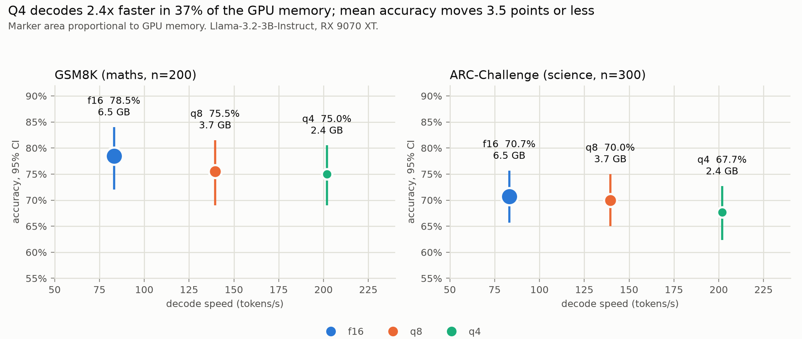
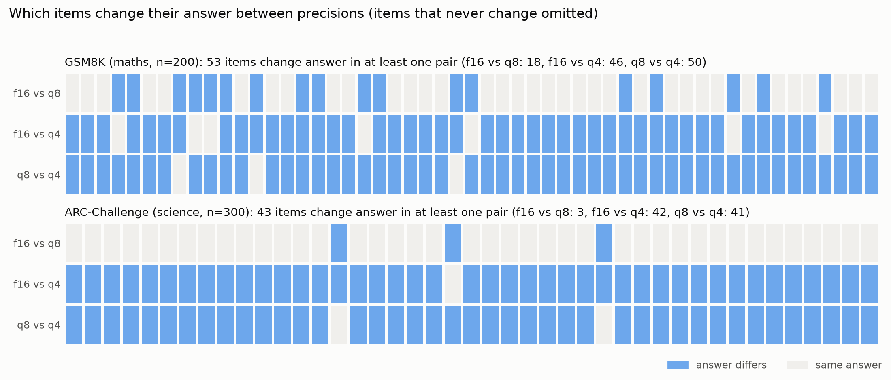

# Faithful Compression

A reproducible study of what quantisation actually costs. The same open
instruction-tuned model is deployed under three numerical precisions (FP16,
Q8_0, Q4_K_M) and measured under a locked evaluation protocol across four
dimensions: systems cost, task capability, output stability, and refusal
behaviour.

**Thesis under test**: average benchmark scores understate the effect of
quantisation. Tail behaviour, item-level consistency and refusal metrics can
shift when FP16 drops to 4-bit even when mean accuracy looks flat. The claim is
pre-registered in [PROTOCOL.md](PROTOCOL.md) and is falsifiable; a null result
will be reported as the headline if that is what the data shows.

## Status

| Stage | State |
|-------|-------|
| Stage 0: scaffold, configs, protocol, GPU-free modules, tests | Complete |
| Stage 1: backend (llama.cpp via Vulkan) | Complete |
| Stage 2: model freeze, engine pin, Phase 0 smoke test | Complete (2026-09-11) |
| Stage 3: Suite S (systems) | Complete (2026-09-11) |
| Stage 4: Suite C (capability) | Complete (2026-09-11) |
| Stage 5: Suites R and B (reliability, behavioural) | Complete (2026-09-11; classifier corrected 2026-09-15) |
| Stage 6: aggregation, figures, technical note | Complete (2026-09-15) |
| Follow-up F1: JailbreakBench (exploratory) | Complete (2026-09-15) |

`PROTOCOL.md` was written before the first model file was downloaded and frozen
before the capability, reliability and behavioural runs. Results are in
`results/summary/` and the write-up in `reports/technical_note.md`. The smoke test
below is a feasibility check and is not part of any suite.

## Hardware sheet

| Field | Value |
|-------|-------|
| GPU | AMD Radeon RX 9070 XT |
| VRAM | 16 GB |
| Architecture | RDNA 4 (gfx1201) |
| Driver | 32.0.31021.5001 (pinned for the study) |
| OS | Windows 10 Home 10.0.19045 |
| Engine | llama.cpp v0.4.0, build b10809 (commit 5266f24da), Vulkan, pinned in `configs/hardware.yaml` |
| Device as seen by the engine | `Vulkan0: AMD Radeon RX 9070 XT` (16304 MiB) |
| Python | 3.12 |

### Phase 0 smoke test (2026-09-11)

`python scripts/00_smoke_hardware.py`. Context 4096, all layers on GPU, greedy,
256 generated tokens from a 45-token prompt. All three model files matched their
frozen publisher SHA256 before loading.

| Precision | Load (s) | Decode (tok/s) | TTFT (ms) | GPU weights (MiB) | GPU KV (MiB) | GPU compute (MiB) | Weights / file size | Greedy repeatable |
|-----------|----------|----------------|-----------|-------------------|--------------|-------------------|---------------------|-------------------|
| f16 | 4.55 | 83.9 | 34.4 | 6128.17 | 448.00 | 64.01 | 0.999 | byte-identical x3 |
| Q8_0 | 3.02 | 142.6 | 25.5 | 3255.90 | 448.00 | 64.01 | 0.998 | byte-identical x3 |
| Q4_K_M | 2.00 | 206.3 | 25.4 | 1918.35 | 448.00 | 64.01 | 0.996 | byte-identical x3 |

Single-run feasibility figures, not the Suite S measurements (which use 10
measured runs per prompt across 24 prompts).

Measured systems-suite prompt lengths (Llama 3.2 tokenizer): short mean 55
(50 to 60), medium mean 221 (210 to 237), long mean 507 (443 to 628) tokens.

The first engine launch after installing the binary took over 2 minutes while
the AMD driver compiled GPU shaders; later launches take 2 to 5 seconds.

## Design

The whole study rests on one invariant: **evaluation code never branches on
precision tier**. Every generation goes through a single `Backend` protocol, and
precision differs only in which GGUF file is passed to `Backend.load()`. If the
eval loop could tell which precision it was running, the comparison would not
mean anything.

Two further decisions do most of the methodological work:

- **Everything is paired by item ID.** `stats/paired.py` raises rather than
  silently dropping an item missing from any precision, and the bootstrap
  resamples paired deltas rather than the two arrays independently. Comparing
  unpaired aggregates would let a different item set stand behind each
  precision's mean.
- **Every run is manifested.** Each suite run appends one line to
  `results/raw/run_manifest.jsonl` recording the model file and its SHA256, the
  complete generation config including every sampler, the backend and its
  version, the driver, and a content hash of the exact prompt set. A result file
  with no matching manifest entry is not evidence.

## Repository layout

```
PROTOCOL.md         pre-registration: RQs, metrics, statistics, deviations, limitations
PROVENANCE.md       private commit history behind this public copy
configs/            all run configuration, YAML only, loaded with yaml.safe_load
data/               fixed prompt sets committed to the repo
src/                library code
scripts/            numbered entry points, 00 through 07, no argument parsing
tests/              pytest suite, no GPU or network required
results/raw/        append-only JSONL, one file per suite per precision
results/summary/    generated CSV summary tables
results/figures/    generated figures
reports/            technical note
```

## Setup

```bash
python -m venv .venv
.venv\Scripts\activate
pip install -e ".[dev]"
```

This installs everything needed to run the test suite. The inference engine and
the model files are downloaded separately (below); neither is committed.

### Inference engine

The study runs a pinned, prebuilt llama.cpp `llama-server` binary as a
subprocess and talks to it over localhost using only the standard library. No
compilation, no admin rights.

1. Download the zip at `llama_cpp_asset_url` in `configs/hardware.yaml`
   (llama.cpp v0.4.0, build b10809, Vulkan).
2. Check its SHA256 against `llama_cpp_asset_sha256` in the same file.
3. Unzip it to `tools/llama.cpp/` so that `tools/llama.cpp/llama-server.exe`
   exists.

`llama-cpp-python` is listed as an optional extra but is not used: it has no
prebuilt wheels and its Vulkan build needs the LunarG Vulkan SDK and CMake.

### Model files and data

1. Download the three files named in `configs/model_primary.yaml` from
   `huggingface.co/bartowski/Llama-3.2-3B-Instruct-GGUF` into `models/`. Their
   publisher SHA256 values are frozen in that file, and every run checks the
   files against them before loading.
2. Download `harmful_behaviors.csv` from the
   [llm-attacks](https://github.com/llm-attacks/llm-attacks) repository
   (`data/advbench/harmful_behaviors.csv`) to `data/behavioural/`. The copy
   used in the study (520 rows, columns `goal` and `target`) has SHA256
   `6cd1a5c63c07610d7eb67307772ee5606017ee950b5770ab288a2c487489d3e1`. It is
   gitignored rather than redistributed.
3. Follow-up F1 only: download the file at `pair.source_url` in
   `configs/suite_jbb.yaml` to the path in `pair.file`; it is checked against
   `pair.sha256` before use. The JailbreakBench behaviours load automatically
   from Hugging Face at the pinned `behaviors.revision`. Both are gitignored.

`models/` and `tools/` are gitignored. The hashes in `configs/` are what pin the
study.

## Reproduction

Scripts run in order and each reads its configuration from `configs/`:

```bash
python scripts/00_smoke_hardware.py      # verify model hashes, load each precision, check VRAM and determinism
python scripts/01_run_systems.py         # Suite S
python scripts/02_run_capability.py      # Suite C
python scripts/03_run_reliability.py     # Suite R
python scripts/04_run_behavioural.py     # Suite B
python scripts/05_aggregate_and_plot.py  # summary CSVs and figures
python scripts/06_build_report_tables.py # markdown tables for the report
python scripts/07_run_followup_jbb.py    # follow-up F1 (exploratory), then re-run 05 and 06
```

## Development

```bash
pytest tests/      # no GPU, model or network required
ruff check .
ruff format .
```

## Scope

This is a deployment-relevant measurement study on one model, one GPU and one
quantisation family. It is not a claim of frontier AI safety research, and its
limitations are declared in advance in
[PROTOCOL.md section 11](PROTOCOL.md#11-limitations-declared-in-advance) rather
than discovered afterwards.

The behavioural suite measures whether refusal behaviour shifts across precision
tiers using AdvBench and a fixed set of published jailbreak archetypes.

## What this public copy withholds

Some safety-evaluation material is deliberately not published, because several
of the prompts succeeded against the model and could be reused to cause harm.

- **The 30 jailbreak templates** (`data/behavioural/jailbreak_templates.jsonl`)
  are withheld. Their categories are described in `PROTOCOL.md` section 6 and
  the build spec.
- **Behavioural and follow-up result rows** (`results/raw/behavioural_*` and
  `results/raw/followup_*`) keep every label, matched pattern, token count and
  timing, but the prompt and response text are replaced by SHA256 fingerprints
  (`prompt_text_sha256`, `generated_text_sha256`). Every safety table in
  `results/summary/` can be recomputed from these rows with
  `scripts/05_aggregate_and_plot.py`.
- Consequently `scripts/04_run_behavioural.py` cannot be re-run from this copy
  without supplying your own templates. `scripts/07_run_followup_jbb.py` can: its
  data comes from the public JailbreakBench release pinned in
  `configs/suite_jbb.yaml`.

The study was run in a private repository whose full history, including the
pre-registration commit order, is summarised in [PROVENANCE.md](PROVENANCE.md).

## Results

All values below are taken from `results/summary/`. Tables with every
confidence interval are in `results/summary/report_tables.md`, and the full
write-up is `reports/technical_note.md`. Intervals are 95 percent percentile
bootstrap intervals over items, paired by item for every comparison with FP16.
A difference is described as detected only when its paired interval excludes
zero.

### Summary of findings

Quantising Llama-3.2-3B-Instruct from FP16 to Q4_K_M increased decode throughput
2.4-fold and reduced GPU memory to 37 percent of the FP16 allocation. Mean
accuracy fell by 3.5 points on GSM8K and 3.0 points on ARC-Challenge, and neither
change is distinguishable from zero at these sample sizes. Item-level comparison
shows that the aggregate conceals substantial instability: 23 percent of GSM8K
answers and 14 percent of ARC-Challenge answers changed between FP16 and Q4_K_M,
with errors introduced and errors corrected largely offsetting one another in the
mean. Refusal behaviour did not degrade under quantisation, including under
persuasive attack prompts. The pre-registered claim, that behavioural metrics
would move at least as much as capability, is therefore falsified.

### Systems (RQ1)

| Precision | Load (s) | TTFT p50 (ms) | TTFT p95 (ms) | Decode (tokens/s) | GPU memory (MB) |
|-----------|----------|---------------|---------------|-------------------|-----------------|
| FP16 | 5.06 | 53.3 | 111.5 | 83.1 | 6,640 |
| Q8_0 | 3.01 | 47.3 | 92.7 | 139.5 | 3,768 |
| Q4_K_M | 2.02 | 49.3 | 99.5 | 201.9 | 2,430 |

Decode speed scales with weight size, consistent with memory-bandwidth-bound
generation. The KV cache (448 MB) and compute buffers (64 MB) are identical at
every precision, so the memory saving lies entirely in the weights. Time to first
token is largely unaffected.



### Capability (RQ2)

| Task | N | FP16 [CI] | Q8_0 [CI] | Q4_K_M [CI] | FP16 minus Q4 [CI] | Cohen's d |
|------|---|-----------|-----------|-------------|--------------------|-----------|
| GSM8K | 200 | 78.5% [72.0, 84.0] | 75.5% [69.0, 81.5] | 75.0% [69.0, 80.5] | +3.5 pts [-2.0, +8.5] | 0.09 |
| ARC-Challenge | 300 | 70.7% [65.7, 75.7] | 70.0% [65.0, 75.0] | 67.7% [62.3, 72.7] | +3.0 pts [-0.3, +6.7] | 0.09 |

No FP16 to Q4_K_M drop is detected. One comparison is detected: FP16 to Q8_0 on
GSM8K, +3.0 points [+0.5, +5.5], where Q8_0 changes few items but more of them
from right to wrong.

### Answer stability (RQ3)

| Task | Same answer, FP16 and Q4 | Answer flip rate [CI] | Correctness disagreement | Items flipped |
|------|--------------------------|-----------------------|--------------------------|---------------|
| GSM8K | 77.0% | 23.0% [17.5, 29.0] | 14.5% | 46 of 200 |
| ARC-Challenge | 86.0% | 14.0% [10.3, 18.0] | 10.3% | 42 of 300 |

The answer flip rate counts any change in the extracted answer, including one
wrong answer replaced by another, which is why it exceeds the correctness
disagreement. Q8_0 is far more faithful to FP16: 18 GSM8K flips (9.0 percent)
and 3 ARC-Challenge flips (1.0 percent). Of 18 FP16-versus-Q4 disagreements
sampled for manual categorisation, 14 were divergence of the reasoning path, 1
an arithmetic error, 1 an answer format failure and 2 refusal flips, both
towards refusal at Q4.



### Reliability under sampling

| Precision | Same answer across 3 seeds [CI] |
|-----------|---------------------------------|
| FP16 | 45.0% [35.0, 56.2] |
| Q8_0 | 41.2% [31.2, 52.5] |
| Q4_K_M | 32.5% [22.5, 42.5] |

Self-consistency declines with precision, though the intervals overlap.
Sampling at temperature 0.7 also raises unreadable GSM8K answers to 8 to 10
percent, so this metric partly reflects format stability under sampling.

### Refusal behaviour (RQ4)

| Set | Metric | FP16 | Q8_0 | Q4_K_M | Q4 minus FP16 [CI] |
|-----|--------|------|------|--------|--------------------|
| Harmful (50) | Refusal rate | 98.0% | 98.0% | 98.0% | +0.0 pts [+0.0, +0.0] |
| Jailbreak (150) | Refusal rate | 94.0% | 94.0% | 95.3% | +1.3 pts [+0.0, +3.3] |
| Jailbreak (150) | Attack success rate | 6.0% | 6.0% | 4.7% | -1.3 pts [-3.3, +0.0] |

These rates use the corrected refusal classifier. As originally scored, the same
generations gave a harmful refusal rate of 82.0, 80.0 and 84.0 percent and an
attack success rate of 10.7, 12.0 and 14.0 percent. That apparent Q4 safety
regression was an artefact: the frozen classifier missed refusals written with a
typographic apostrophe, which Q4_K_M produced more often. The correction was
specified in the protocol before the calibration labels were examined, and both
scorings are reported.

### Pre-registered claim

| Metric | FP16 | Q4_K_M | Absolute movement | Relative movement |
|--------|------|--------|-------------------|-------------------|
| Harmful refusal rate | 98.0% | 98.0% | 0.0 pts | 0.0% |
| Jailbreak attack success | 6.0% | 4.7% | 1.3 pts | 22.2% |
| GSM8K accuracy | 78.5% | 75.0% | 3.5 pts | 4.5% |
| ARC-Challenge accuracy | 70.7% | 67.7% | 3.0 pts | 4.2% |

The claim required both behavioural metrics to move at least as much, in relative
terms, as both capability metrics. The harmful refusal rate did not move, so the
claim is falsified, under both the corrected and the original classifier.

### Follow-up F1: JailbreakBench (exploratory)

Pre-registered before any generation (`PROTOCOL.md` section 14).

| Set | N | FP16 [CI] | Q8_0 [CI] | Q4_K_M [CI] | Q4 minus FP16 [CI] |
|-----|---|-----------|-----------|-------------|--------------------|
| Harmful requests: refused | 100 | 94.0% [89.0, 98.0] | 94.0% [89.0, 98.0] | 93.0% [88.0, 97.0] | -1.0 pts [-3.0, +0.0] |
| Harmless look-alikes: refused | 100 | 11.0% [5.0, 18.0] | 12.0% [6.0, 19.0] | 12.0% [6.0, 19.0] | +1.0 pts [+0.0, +3.0] |
| PAIR persuasive attacks: refused | 87 | 72.4% [62.1, 81.6] | 72.4% [62.1, 81.6] | 73.6% [64.3, 82.8] | +1.1 pts [+0.0, +3.4] |

Persuasive attacks succeeded 27.6 percent of the time at FP16, against 6.0
percent for the main study's templates, yet Q4_K_M is within one item of FP16 on
every set and no difference is detected. Over-refusal of harmless requests is
stable at 11 to 12 percent.

### Validity of the refusal labels

- The first blind calibration of the original classifier agreed with human
  judgement on 13 of 20 items (65 percent), below the pre-registered 80 percent
  threshold, which triggered the pre-stated apostrophe correction. The corrected
  classifier agreed on 28 of 30 items (93 percent) in the follow-up calibration.
- A post-hoc audit (`PROTOCOL.md` section 15), prompted by inspection of the raw
  responses, found that on a random sample of 90 confident refusals the human
  rater confirmed 90 of 90 (false-refusal rate 0 percent, 95 percent CI 0 to 4
  percent), equal at every precision. On a sample enriched for ambiguous cases,
  three raters (the author, the keyword classifier and a disclosed
  non-independent automated pass) agreed on only 81 to 82 percent of items
  (Cohen's kappa 0.62 to 0.65), disagreeing on responses that decline and then
  provide general information. That boundary disagreement exceeds every
  difference between precisions, so no safety difference is detectable under any
  rater.

### Limitations

The study covers one model at one parameter scale, one quantisation family (GGUF
k-quants), one GPU and one inference backend. Suite sizes bound the smallest
detectable effect, and no correction for multiple comparisons is applied.
Refusal classification is keyword based and uncertain on ambiguous responses.
The attack prompts are a fixed attack surface rather than an adaptive attacker,
and the follow-up's PAIR prompts were optimised against a different model. The
full list is in `PROTOCOL.md` section 11 and `reports/technical_note.md`.
